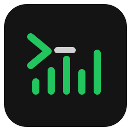

  

<h1 align="center">YouTerm</h1>

<strong>Sua música, do seu jeito.</strong>

O **YouTerm** é um player de música de código aberto para Linux que se conecta ao **YouTube Music**. Ele combina um visual inspirado em terminais com uma interface que você pode personalizar para combinar com o seu estilo.

## Um player com a sua cara

- **Personalize o visual:** escolha entre temas como Tokyo Night, Dracula, Nord e Gruvbox, ou crie o seu próprio tema.
- **Cuide de cada detalhe:** ajuste cores, fontes, tamanho do texto, espaçamento, animações e efeitos retrô.
- **Compartilhe seus temas:** importe e exporte suas criações para levar seu estilo com você.
- **Veja a música acontecer:** alterne entre capas em arte ASCII, listas de faixas e um visualizador de áudio.
- **Ouça e organize:** busque músicas, gerencie playlists, monte sua fila e conecte sua conta para acessar sua biblioteca do YouTube Music.
- **Use o teclado:** controle a reprodução e navegue pelo player com atalhos.

A interface é feita com **React e CSS**. Como o código é aberto, você também pode modificar o player e criar novas possibilidades de personalização.

## Baixar

O YouTerm está disponível para **Linux (x86_64)** em formato **AppImage**.

**[Baixar o YouTerm](https://github.com/RDSM243/YouTerm/releases/latest)**

Baixe o arquivo `.AppImage`, permita sua execução nas propriedades do arquivo e abra o player.

Versões para **Windows e macOS** estão nos planos para o futuro.

## Faça parte

Ideias, temas, sugestões e contribuições são bem-vindos. Conte o que você gostaria de ver no player nas [issues](https://github.com/RDSM243/YouTerm/issues) ou envie uma contribuição.

O YouTerm é distribuído sob a [licença MIT](./LICENSE).
