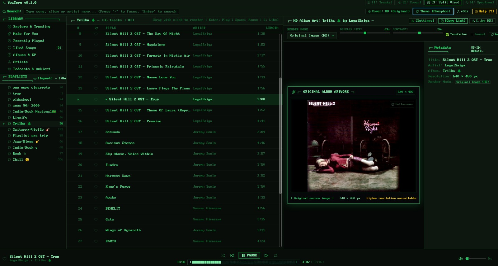

  

<h1 align="center">YouTerm</h1>

<strong>Your music, your way.</strong>

**YouTerm** is an open source music player for Linux that connects to **YouTube Music**. It brings the look of a terminal to your music library, with an interface you can customize to match your style.

## Make it yours

- **Choose your look:** pick a theme such as Tokyo Night, Dracula, Nord or Gruvbox, or create your own.
- **Fine-tune the details:** customize colors, fonts, text size, spacing, animations and retro effects.
- **Set your background:** import an image in Settings → Appearance and adjust brightness, dark overlay and panel opacity. Choose independently whether to show it behind the sidebar, player bar and Spectrum. Settings stays opaque.
- **Share your themes:** import and export your creations.
- **See your music:** switch between album artwork, ASCII art, track lists and an audio visualizer.
- **Listen and organize:** search for music, manage playlists, build your queue and connect your account to access your YouTube Music library.
- **Keep your hands on the keyboard:** control playback and navigate the player with shortcuts.

The interface is built with **React and CSS**. With the source code available, you can also modify the player and take customization further.

## Download

YouTerm is available for **Linux (x86_64)** as an **AppImage**.

**[Download YouTerm](https://github.com/RDSM243/YouTerm/releases/latest)**

Download the `.AppImage` file, allow it to run in your file manager's properties and open the player.

**Windows and macOS** versions are planned for the future.

## Get involved

Ideas, themes, feedback and contributions are welcome. Share what you would like to see in the player by [opening an issue](https://github.com/RDSM243/YouTerm/issues) or submitting a contribution.

YouTerm is distributed under the [GNU GPLv3 license](./LICENSE).
